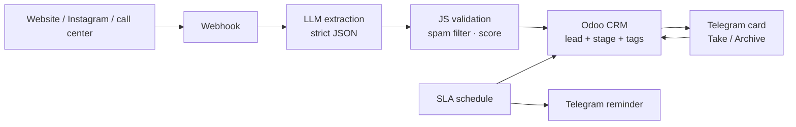

# AI Lead Qualification for Odoo CRM

> Inbound leads → LLM extraction & scoring → lead created in Odoo CRM → Telegram card with action buttons → SLA reminders.

  

## Problem

A smart-home company received inquiries from several channels (Instagram, targeted ads, call center, partners). Managers copied them into the CRM by hand, hot leads waited too long, and some leads were lost.

## Solution

Started with an as-is → to-be map of the sales process with the team, then built it in **n8n**:

1. **Lead intake** — a webhook receives the inquiry; an LLM (Gemini) extracts contact, object type, area, budget, timeline and systems into strict JSON
2. **Validation & scoring** — JavaScript checks the data, filters spam and computes a 0–100 score (hot / warm / cold)
3. **Odoo CRM** — the lead is created via the Odoo API with the right stage, team, tags and custom properties
4. **Manager buttons** — the manager gets a Telegram card with "Take / Archive" buttons that update the lead stage in Odoo
5. **SLA control** — a scheduled workflow reminds the manager if a new lead is not handled in time
6. **Test sender** — 5 realistic test leads to demo the whole flow

## Architecture

## Tech stack

- n8n
- Google Gemini (LLM)
- Odoo CRM (JSON API)
- JavaScript
- Telegram Bot API

## Results

- A lead reaches the CRM and the manager within seconds
- Spam is filtered before it reaches the CRM
- No lead is left unanswered thanks to SLA reminders

## Workflow files

Workflow JSON exports are in [`workflows/`](workflows). Credentials, IDs and personal data are removed: import into n8n and connect your own credentials.

## Author

**Kyrylo Kirillov** — AI Automation Engineer (n8n, Make, LLM agents)  
[Upwork](https://www.upwork.com/freelancers/~019bcb1ca9cd59b3ad) · [LinkedIn](https://www.linkedin.com/in/kirillov-kirill) · [Portfolio](https://tree-plantain-8cf.notion.site) · Telegram [@Veter218](https://t.me/Veter218)

